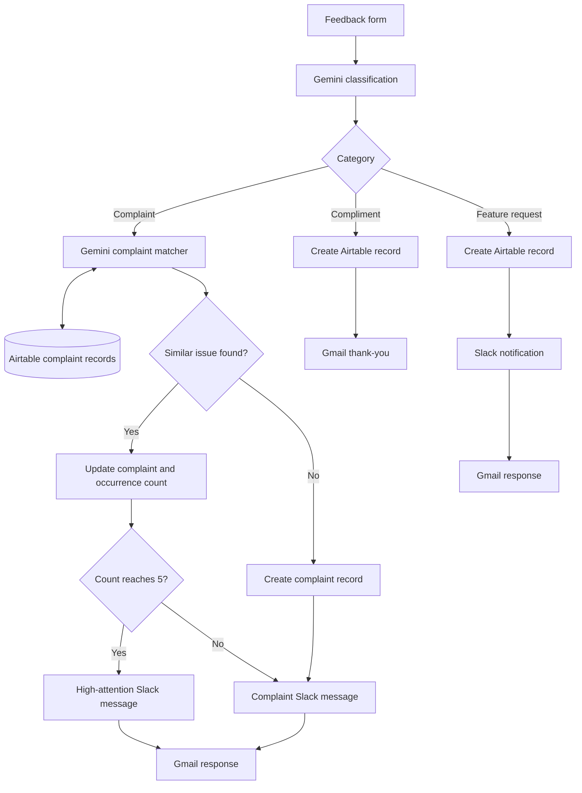

# 💡Feedback AI Agent

An n8n workflow that classifies customer feedback and routes it to connected services for storage and follow-up.

## Overview

Feedback AI Agent is a hands-on n8n automation project for processing feedback submitted through an n8n form. It uses a Google Gemini model to classify each submission, then routes it to category-specific Airtable, Slack, and Gmail steps.

🚀The workflow is intended to make feedback easier to organize and bring repeated complaints to a team's attention. It is an integration prototype, not a hosted application: the workflow is inactive in the included export and requires service credentials and configuration before use.

## How It Works

1. A customer submits their name, email address, and feedback through the n8n form.
2. Google Gemini classifies the feedback as `Complaint`, `Compliment`, or `feature addition request`.
3. n8n routes the submission by category:
   - **Complaint:** the workflow is configured to search complaint records in Airtable and use a second Gemini agent to check for a similar issue. A matching record is updated; otherwise, a complaint record is created. The complaint path then sends a Slack notification and an acknowledgement email. A configured condition routes reports at the threshold of five to a high-attention Slack message.
   - **Compliment:** the feedback is created in the `Compliment` Airtable table, followed by a thank-you email.
   - **Feature request:** the feedback is created in the `feature addition request` Airtable table, sent to Slack, and followed by an acknowledgement email.

The complaint matching and repeat-count behavior needs validation before operational use. See [Current Status](#current-status).

## Workflow Architecture



This diagram describes the configured node connections. Successful execution depends on valid credentials, matching Airtable fields, and completing the complaint-path checks described below.

## Key Features

- Form-based collection of a customer's name, email address, and feedback.
- Gemini-based classification with three configured categories.
- Separate Airtable tables for complaints, compliments, and feature requests.
- A complaint branch configured to search existing Airtable complaint records and update or create a record.
- Slack messages for complaints and feature requests, with a separate high-attention complaint message path.
- Gmail responses for all three categories.
- Docker Compose configuration for running a local n8n instance with persistent n8n data.

## Tech Stack

| Technology or service | Use in this project |
| --- | --- |
| n8n | Workflow automation, form trigger, routing, and integrations |
| Google Gemini | Feedback classification and configured complaint matching |
| Airtable | Feedback records and complaint lookup/update |
| Slack | Complaint and feature-request notifications |
| Gmail | Automated customer responses |
| Docker Compose | Local n8n runtime |

## Project Structure

```text
.
├── .env.example
├── .gitignore
├── docker-compose.yml
├── README.md
├── screenshots/
│   ├── airtable.png
│   ├── slack.png
│   └── workflow.png
└── workflow/
	└── customer feedback.json
```

- `docker-compose.yml` runs the n8n container and mounts a named volume for persistent n8n data.
- `.env.example` contains non-secret defaults for the local n8n container; copy it to `.env` before starting Compose.
- `.gitignore` excludes local environment files and common OS-generated files.
- `workflow/customer feedback.json` is the exported n8n workflow.
- `screenshots/` contains example views of the workflow and connected services.
- There is no application source code, dependency manifest, or automated test suite in this repository.

## Setup and Installation

### Prerequisites

- Docker Desktop or Docker Engine with the Docker Compose plugin.
- Accounts and API access for Google Gemini, Airtable, Slack, and Gmail.
- An Airtable base with the tables and fields described under [n8n Workflow Setup](#n8n-workflow-setup).

### Start n8n

From the repository root, copy the example configuration to `.env`, then start n8n:

```powershell
Copy-Item .env.example .env
docker compose up -d
```

Open [http://localhost:5678](http://localhost:5678) and complete n8n's initial setup. Check that the container is running with:

```bash
docker compose ps
```

The Compose file uses the `docker.n8n.io/n8nio/n8n:latest` image and stores n8n's local data in the `n8n_data` named volume. The workflow is not automatically imported into the container.

## Environment Variables

The `.env.example` file provides non-secret local defaults for `N8N_HOST`, `N8N_PORT`, `N8N_PROTOCOL`, `WEBHOOK_URL`, `N8N_SECURE_COOKIE`, and `TZ`. Docker Compose reads the `.env` file created from this template. Change the host, webhook URL, and cookie settings as appropriate if the runtime address or deployment environment changes.

Service credentials are configured inside n8n and are not supplied as environment variables in this repository. The `.gitignore` excludes `.env` and other `.env.*` files while keeping `.env.example` tracked. Do not commit API keys, OAuth tokens, or passwords.

## n8n Workflow Setup

1. In the n8n interface, import `workflow/customer feedback.json` using **Import from File**.
2. Create or select credentials for both Google Gemini model nodes, the Airtable Personal Access Token, Slack OAuth2, and Gmail OAuth2. The credential references in an export do not include usable credentials; select the credentials available in your n8n instance.
3. Confirm the Airtable base and table selections. The exported workflow references a base named `customer feedback` and tables named `Complaint`, `Compliment`, and `feature addition request`; change the selections if your base uses different tables.
4. Ensure the `Complaint` table has the fields used by its nodes: `Name`, `Email`, `feedback`, `Issue`, `Occurrence count`, and `Last Reported`. The export also declares `First reported` in a node schema, but does not map a value to it. The other two tables use `Name`, `Email`, and `feedback`.
5. In the Slack nodes, choose channels that the connected Slack account can post to. The export currently targets channels named `complain` and `feature-addition-request`.
6. Review the complaint matching prompt, Airtable count mapping, and timestamp mapping as described under [Current Status](#current-status).
7. Test the workflow, then activate it in n8n to use its production form URL. The workflow is marked inactive in the included JSON export.

## Testing

Use n8n's test mode and the form's generated test URL to submit sample feedback. Try one clear example from each category, then submit a complaint with similar wording more than once to inspect the complaint path.

For each run, review the n8n execution and verify the expected Airtable record, Slack message where configured, and Gmail response. Confirm that the repeat count and high-attention route behave as expected before using the workflow with real customers. The repository does not include automated tests or a mock service environment.

## Docker

Docker Compose runs only the n8n service; it does not run Airtable, Slack, Gemini, or Gmail locally. The `n8n_data` volume persists n8n state, such as local configuration and imported workflows, across container recreation. Feedback records remain in Airtable. Stop the local service with:

```bash
docker compose down
```

The Compose configuration is intended for local development. It uses `latest`, sets `N8N_SECURE_COOKIE=false`, and points `WEBHOOK_URL` at localhost, so it is not a production deployment configuration.

## Deployment

No cloud, hosting, or production deployment configuration is included. The current setup runs n8n locally at `http://localhost:5678`. A public deployment would need an externally reachable n8n host, HTTPS, appropriate webhook and cookie settings, secured credentials, and operational backups and monitoring.

## Why I Built This

This is a hands-on learning project for understanding AI workflow automation, APIs, third-party integrations, conditional routing, databases, Docker, and deployment concepts. AI coding tools can generate similar workflows from prompts, but I manually configured this project to learn how its individual components communicate and work together.

## Current Status

**Configured in the workflow export:** feedback form, Gemini category classification, category routing, Airtable create/search/update nodes, Slack notification nodes, Gmail response nodes, and a complaint occurrence threshold branch. Docker Compose is configured for local n8n use.

**Not ready to rely on without verification:** the workflow is inactive and credentials are not included. The complaint-matching agent's prompt does not explicitly include the submitted complaint text. The matching/count update path should be checked in n8n to confirm the incoming issue and occurrence count are available to its expressions. The `Last Reported` update is a fixed timestamp in the export rather than a dynamic current time. No automated test or cloud deployment is provided.

## Future Improvements

- Pass the new complaint explicitly into the similarity prompt and improve matching confidence and review behavior.
- Verify and correct occurrence-count mappings and use a dynamic `Last Reported` timestamp.
- Add feedback priority scoring.
- Build an analytics dashboard for feedback trends.
- Improve error handling and alerting for failed integrations.
- Add workflow monitoring and operational documentation.
- Prepare and validate a secure production deployment.

## Author

Samruddhi Waykar
